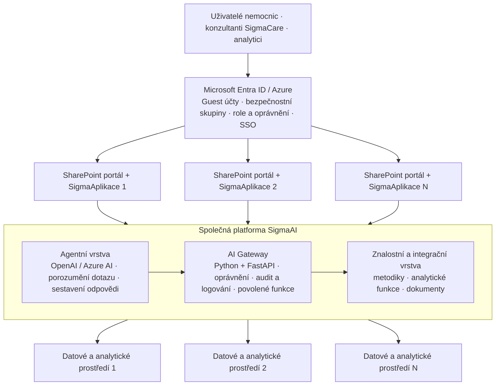

# SigmaAI – referenční architektura pro více projektů

> **PRIORITA 1 – aktivní směr vývoje SigmaCare.** Toto je pracovní přepis referenčního diagramu dodaného 27. 10. 2026. Původní obrázek byl předán v konverzaci; tato stránka zachovává jeho obsah v textové a editovatelné podobě. **Nejde ještě o schválený implementační návrh.**

**Vize:** „Jedna společná platforma, oddělené aplikace, data a oprávnění.“

## Architektonický diagram – editovatelná reprezentace

Každá **SigmaAplikace** má vlastní portál a uživatelský kontext. V portálu jsou **Metodiky, Analýzy, Power BI / aplikace a AI chat**.

Každé **datové a analytické prostředí** má podle diagramu: **CSV datový sklad, číselníky, primární data, zpracovaná data, data pro reporting, IBM SPSS Modeler, Python výpočty a predikce**.

## Co je společné a co oddělené

| Vrstva | Sdílená mezi projekty | Oddělená pro projekt |
|---|---|---|
| Identita | Microsoft Entra ID a mechanismus přihlášení | Role, bezpečnostní skupiny, oprávnění |
| Uživatelské prostředí | Technologický vzor portálu | SharePoint portál, SigmaAplikace a uživatelský kontext |
| AI | Agentní vrstva, AI Gateway, znalostní a integrační mechanismy | Přístupné nástroje, metodiky a kontext |
| Data | Společné technické principy | Datová a analytická prostředí jednotlivých projektů |
| Audit | Společná infrastruktura logování | Dohledatelnost a autorizace podle projektu a identity |

## Cílové schopnosti – pracovní rozšíření nad obrázkem
Tyto body **nejsou explicitně zakreslené** v referenčním obrázku; jsou to naše požadavky na rozvoj SigmaAI:
1. Automatické controllingové kontroly a monitoring desítek klinik.
2. Detekce anomálií, trendů a odchylek plán–predikce–skutečnost.
3. Navazující povolené analytické funkce a prioritizace nálezů.
4. Vysvětlitelné komentáře, oddělení faktů a hypotéz, odkazy na metriky.
5. Interaktivní analytik v portálu; případné MCP rozhraní až podle rozhodnutí.
6. Bezpečné oddělení klientů, minimální oprávnění, schvalování a audit.

## Technická rozhodnutí k potvrzení
- Agentní vrstva: Microsoft Foundry / Azure OpenAI / jiné schválené LLM?
- AI Gateway: umístění FastAPI v Azure, síťové hranice, autentizace, autorizace po jednotlivých projektech.
- Jak bude vynucováno oddělení nemocnic i při volání analytických funkcí a při použití LLM?
- Kde fyzicky leží CSV/datový sklad, jak se přistupuje k Azure Data Lake, jaké jsou aktualizace?
- Jak budou připojeny Modeler, Python a případně Microsoft Fabric?
- Výstupy: Power BI, SigmaAplikace, AI chat; kdo schvaluje závěry?
- Testovací prostředí, syntetická data a ověřovací scénáře.
- Jaké části společné platformy vyvineme s Romanem a které poskytne SigmaCare?

## První pilot – doporučená posloupnost
1. **Jedna SigmaAplikace, jedna nemocnice/testovací projekt, jeden schválený datový model** – bez přístupu k produkčním datům.
2. Syntetické CSV a číselníky se stejným schématem; simulované výstupy Modeleru.
3. Python analytické jádro: kvalita dat, KPI, anomálie, navazující kontroly.
4. FastAPI/AI Gateway s oprávněními, auditem a volitelným schváleným LLM.
5. Testovací Power BI / portál s dohledatelnými komentáři.
6. Integrace do testovacího Azure, bezpečnostní testy a postupné rozšíření.

**Zásada:** sdílet kód a technologii, **nesdílet automaticky data ani oprávnění mezi nemocnicemi**. Pseudonymizovaná zdravotní data zůstávají osobními údaji.

## Vazby na předchozí podklady
- [Otázky ke schůzce a pilotu](../schuzky-a-temata/2026-10-23-dotazy-ke-schuzce.md)
